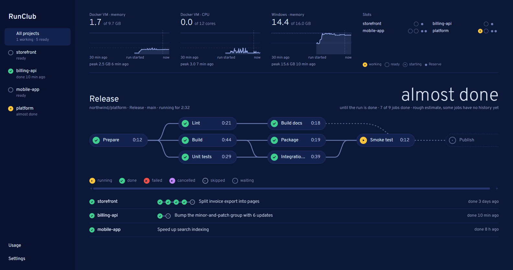
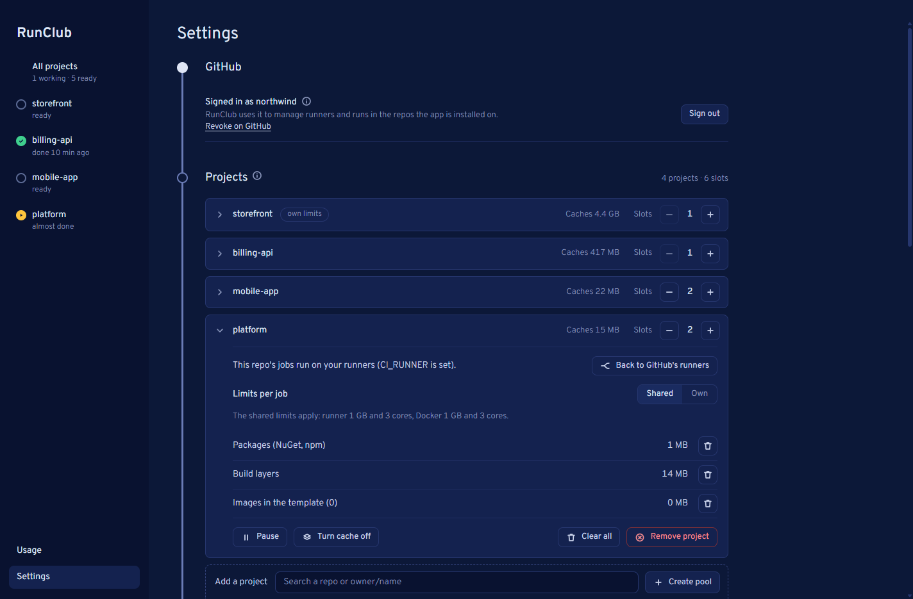
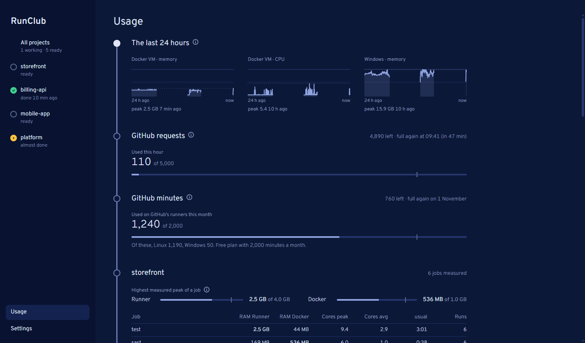

# RunClub

Self-hosted GitHub Actions runners on your own Windows machine. Every job gets a fresh Linux container with its own
Docker daemon, and is still quick to start: RunClub keeps a reserve of prepared runners and caches per repo. It sits
in the notification area and shows in a window what your runs are doing right now.



## What it does

- **Runners without typing.** Pick a repo, and RunClub registers runners for it, switches its jobs to them and back.
- **A clean machine per job.** Each job runs in a new container with its own Docker; nothing of a job's containers is
  left for the next one. Only the caches carry over: packages, build layers and the images your jobs use, per repo,
  so the setup costs little.
- **Runs you can follow.** Each run is drawn as a network of its jobs (`needs`), with times and an estimate of when
  the run is done, learned from earlier runs.
- **Load in view.** Memory and CPU of the Docker VM, memory of Windows, the peak of each job against its limit, and a
  suggestion for the limits from what was measured.
- **GitHub's quotas.** The request budget of the hour and the Actions minutes of your account this month (Free and
  Pro plans), with a warning before GitHub stops running jobs of private repos on its own runners.

## Requirements

- Windows with Docker Desktop on WSL (if one of them is missing, RunClub says what to do and starts Docker Desktop on click)
- a GitHub account with admin rights on the repos
- private repos only: a public repo gets no pool, and one that turns public pauses (see [Security](#security)); in an
  organization, “Run workflows from fork pull requests” must be off
- Linux x64 jobs: jobs for Windows or macOS stay with GitHub's runners
- Node.js only for development (see below); the installer brings everything along

## Installing

Download the installer `RunClub-Setup-X.Y.Z.exe` from the [releases](https://github.com/Zaho92/RunClub/releases) and
run it. The installer is not signed, so Windows
warns “Unknown publisher” (“More info” → “Run anyway”). RunClub ends up in `%LOCALAPPDATA%\Programs\runclub`, with a Start menu shortcut; the data lives in
`%APPDATA%\RunClub` and is kept when updating and uninstalling.

## Getting started

1. **Sign in.** RunClub asks for it on first start: it shows a one-time code, you confirm it in the browser.
2. **Install the GitHub App** [RunClub](https://github.com/apps/runclub-runners/installations/new) for your own
   account and every organization whose repos should get runners. RunClub links there as well when a repo is out
   of its reach.
3. **Let the workflows read the repo variable `CI_RUNNER`**, in every job that should run on your machine:

   ```yaml
   runs-on: ${{ fromJSON(vars.CI_RUNNER || '"ubuntu-latest"') }}
   ```

   With `CI_RUNNER` set to `["self-hosted","Linux"]`, the jobs come to RunClub; without it, they go to GitHub's
   runners, so you can switch at any time without touching the workflows. Jobs that ask for
   `runs-on: [self-hosted, Linux]` directly run on RunClub without the variable.
4. **Add a project:** on first start RunClub offers your repos right away, later under Settings → Projects (search
   the repo, “Create pool”). RunClub registers its runners and, if the workflows read `CI_RUNNER`, sets it. If you
   change the workflows later, “Switch to my runners” in the project's settings sets it; “Back to GitHub's runners”
   removes it again.



Per project you set the slots (how many jobs run at the same time), the limits per job (shared or its own) and
see the caches. Usage shows the last 24 hours, GitHub's quotas and, per project, what each job needed:



### What RunClub may do on GitHub

RunClub talks to GitHub through its own GitHub App and acts only in the repos the app is installed on. Per repo
the app may register and unregister runners (Administration), read and re-run runs (Actions), set `CI_RUNNER`
(Variables), read check results (Checks) and read code (Contents, for the workflow files),
plus the account's billing for the minutes quota (Plan). It cannot change code directly; Administration, however,
also allows changing a repo's settings, collaborators and visibility (RunClub uses it only for the runners).

The token is valid for eight hours and renews itself; it is stored encrypted with the key of the Windows user
in `%APPDATA%\RunClub\data\github.token`. Signing out forgets it on this machine; you revoke the grant at
GitHub under [Authorized GitHub Apps](https://github.com/settings/apps/authorizations). The backend alone
(`npm run backend`) keeps the token in memory only.

## Updating

RunClub checks the releases shortly after starting and then every six hours, downloads a newer version in the
background and verifies it: every release carries a manifest signed by the maintainer, and RunClub only accepts an
installer whose size and SHA-512 match it (details in `SECURITY.md`, “Updates”). It is only installed on click (Settings → App →
“Update now”), and only when no runner is working: RunClub then tears down all runners as on quitting, starts
the installer and opens again afterwards.

The channel is set in the same settings: **Stable** gets only approved versions, **Beta** also pre-releases.
RunClub reads the releases without signing in; the token of the sign-in is not sent for it.

## Quitting

Closing the window ends nothing. Quit via the icon in the notification area (right-click → “Quit (stop runners)”)
or “Quit RunClub” in the settings; the runners end as well.

## What jobs should know

A job's Docker daemon runs without privileges in a container of its own and has its own network there. Ports that a job
publishes (`docker run -p`, `services:` in the workflow) are reached by the runner on `localhost`; `--network host`,
on the other hand, means the daemon's network, not the runner's. So a container with `--network host` sees no services
that a step starts in the runner on `localhost`, and vice versa.

## Security

The trust model in detail, and how to report a vulnerability: [`SECURITY.md`](SECURITY.md).

No runner container runs with `--privileged`: each job's Docker daemon and the build service run as
ordinary users (rootless). Whoever breaks out of a container that a job starts lands in the daemon container
of its job, not in the Docker VM. The job's steps themselves have root in the runner container via `sudo`, with
Docker's usual capabilities minus `NET_RAW`, `MKNOD`, `SETFCAP`, `SETPCAP`, `SYS_CHROOT` and `NET_BIND_SERVICE`; whoever
breaks out of the runner container is root in the Docker VM. This does not protect against every attack; only code
you trust should run on the runners. That is why pools exist only for private repos, and if a repo becomes public,
its pool pauses.
Dependabot proposes new versions of the pinned images (`linux/Dockerfile`, `linux/pins.Dockerfile`).

Only the app's own window gets the interface and its data: under Docker Desktop the service is also reachable from the
jobs' containers, so it requires a key that is created anew at every start
(`access.key` in the data folder, see `src/access.js`). This is meant for the app's own window. Anyone who opens the entry address
in an ordinary browser instead should know: the cookie there applies to all ports on `127.0.0.1`,
so also to other local services, and the address with the key stays in the history.

## Configuration

Settings, learned data and the log live under `%APPDATA%\RunClub\data`.

Environment variables: `RUNCLUB_DATA` (data folder), `RUNCLUB_PORT` (port of the service, otherwise 8770) and
`RUNCLUB_SUBNETS` (range from which the runners' networks get their subnet, otherwise `10.213.0.0/16`; from /8 to /24.
Only needed if the range is already taken, for example by a VPN). For a Docker engine other than Docker Desktop:
`RUNCLUB_DOCKER_HOST` (endpoint of the daemon, passed to the CLI as `DOCKER_HOST`; preferably a named pipe or `ssh://`,
a `tcp://` only with TLS via `RUNCLUB_DOCKER_CERTS`, the folder with `ca.pem`, `cert.pem` and `key.pem`, because otherwise
anyone who reaches the port, including a job, controls the daemon) and `RUNCLUB_DOCKER_DISTRO` (WSL distro of the daemon for
measuring the VM; if unset `docker-desktop`, with a custom endpoint none; empty: no measurement). Without
`RUNCLUB_DOCKER_HOST`, whatever the Docker CLI uses anyway applies (including a `DOCKER_HOST` or context of the user).

## Development

```sh
npm run check   # syntax of all scripts, including the script in the interface
npm test        # tests of all modules except backend.js and main.js
```

The same two steps run as CI on every push and pull request (`.github/workflows/ci.yml`).

Start without the installer:

```sh
npm install
npm start
```

Next to the installed app, a development instance runs only with its own data folder and port and only as a service
(`RUNCLUB_DATA` to an empty folder, `RUNCLUB_PORT` to another port, `npm run backend`). Two instances must never
serve the same repos: each unregisters the other's runners at GitHub. Build the installer locally: `npm run dist` (ends up in `dist/`).

`npm run backend` starts only the service, without a window (data then under `%APPDATA%\RunClub\backend`, separate from the app's); the address to open is then printed in the console.

### Structure

| Path | Contents |
| --- | --- |
| `src/main.js` | Window, notification area, start with Windows |
| `src/backend.js` | Wiring only: `start()` creates the modules, starts the timers and the local service and shuts everything down again (sequence in `src/lifecycle.js`) |
| `src/lifecycle.js` | Start and end of a program run: timers, starting the pools, key file, quitting, fast unregistering when signing out of Windows |
| `src/settings.js`, `src/names.js` | Settings and learned data in the data folder; names of the images, tags and names of the caches and build services per repo |
| `src/runners.js` | Wires template, slots, caches and pools together (also for the tests) |
| `src/remote.js` | What is read from GitHub: runs and jobs, rate limit, repos of the account, waiting runs, visibility of the repos; re-running runs |
| `src/account.js` | Sign-in to GitHub and minutes quota in the same timer |
| `src/usage.js` | Measurement: `docker stats`, VM memory, Windows load, usage per job |
| `src/status.js`, `src/actions.js`, `src/server.js` | What the interface sees, what it can trigger, and the local service for it |
| `src/engine.js` | Where Docker runs (today Docker Desktop): CLI calls, endpoint, WSL distro for measuring the VM |
| `src/setup.js` | What the machine lacks for Docker while it does not answer: WSL, Docker Desktop installed, started, its engine; starting Docker Desktop |
| `src/dockerwatch.js` | The Docker watch: prepare as soon as Docker answers, check regularly, build the two own images (runner and Docker daemon), clean up leftovers |
| `src/dind.js` | The Docker daemon in a container (daemon of a pair, loader daemon of the template): image, user, socket, options for running without privileges, waiting until it answers; the same image as a tool for volumes |
| `src/externals.js` | The runner's tools (`/home/runner/externals`) for container jobs: a read-only copy per runner image as a volume for the pairs' daemons, older copies removed |
| `src/slots.js` | Life cycle of a slot: set up a pair, register the runner, serve a job, clean up, abort when idle |
| `src/pools.js` | Create and prepare a pool, a pool's reserve (refill, renew, tear down), adjust the number of slots, bring a pool to rest |
| `src/seed.js` | Template of a repo: learn a job's images, refresh the template, lock copying and refreshing against each other |
| `src/housekeeping.js` | The timer of the cleanup work at GitHub: check the visibility of the repos (pause those that became public) and unregister orphaned runners, only when the rate limit allows it |
| `src/blocks.js` | Why a pool can be blocked (repo became public, fork PRs may run in an org repo, or that cannot be read): the reason kept in the pool's settings, the first one that applies |
| `src/forks.js` | Whether workflows from fork pull requests could run code on your own runners: in an org repo, read the setting at GitHub; if it cannot be read, the repo counts as exposed |
| `src/caches.js` | Provide a repo's package cache and build service (without privileges, reachable through a socket), recreate them with new limits or after a failure, clear them, measure the volumes |
| `src/pipeline.js` | Runs with their jobs, dependencies from the workflow file (`needs`), usual duration, remaining time |
| `src/metrics.js` | History of the load on Windows and the Docker VM, usage per job |
| `src/vmmemory.js` | Memory of the Docker VM from `/proc/meminfo` (with kernel and daemon), rule for the warning when hardly any memory is free |
| `src/routing.js` | Repo variable `CI_RUNNER`: switches a repo's jobs to the self-hosted runners and back |
| `src/access.js` | Who may use the local service: key per program run, cookie, headers of the page |
| `src/limits.js` | Limits per job: bounds from the Docker VM, suggestion from the measurements, default and outliers |
| `src/github.js` | GitHub's REST API via `fetch`: conditional requests (ETag), state of the rate limit, when to poll less often or not at all, token renewal on 401, errors with status |
| `src/auth.js` | Sign-in through the GitHub App (device flow): one-time code, waiting for confirmation, cancelling, signing out; renewing the token and storing it encrypted |
| `src/minutes.js` | GitHub Actions minutes quota: the month's usage from the account's billing (per operating system, paid), included minutes assumed per plan, state tight, used up or paid, when to read again |
| `src/messages.js` | Messages to the interface as keys with values (`{ key, args }`), with the English sentence for the log file and error text; the interface translates them with its tables |
| `src/journal.js` | Log: entries with time, project, message and kind; the latest in memory and for the next start in `runclub.log.entries`, all readable in `runclub.log` (in English from 0.1.0-beta.5 on) |
| `src/subnets.js` | Networks of the pairs and build services: a random /28 each from a separate range instead of from Docker's scarce pool |
| `src/waiting.js` | Runs without a pool that make no progress: repos of the account in which jobs wait for a self-hosted runner or runs failed on GitHub's used-up quota |
| `src/shutdown.js` | The state while RunClub shuts down: runners dismantled per project, job being cancelled, the stages cleanup and sign-off; stored durations for estimating the next shutdown |
| `src/updater.js` | Updating from the GitHub releases: channel Stable/Beta, download in the background, check against the signed manifest (size, SHA-512), report a ready update; installed only on click (`src/main.js`) |
| `src/signature.js`, `src/versions.js` | Signed updates: manifest, Ed25519 signature, the app's public keys (primary and backup), the checks a manifest must pass; version numbers and their channel |
| `src/run.js`, `src/store.js`, `src/images.js`, `src/pairs.js`, `src/states.js`, `src/units.js`, `src/numbers.js` | Program calls with a time limit and abort from outside (on Windows the program is only looked up in PATH), files in the data folder, rules for learned images, names of the runner pairs, states of a slot, units for time and memory, median |
| `src/ui.html` | Interface: project rail, network map per run, load, usage, settings (German and English) |
| `src/fonts/` | Font Overpass (OFL), shipped with the app so that it works without internet |
| `linux/` | Image of the runners (`Dockerfile`, with `docker-shim.sh`), image of the Docker daemon without privileges (`dind/Dockerfile`) and the pinned images of daemon and build service (`pins.Dockerfile`, only read, not built), the seccomp profile of the daemons (`seccomp.json`, generated) |
| `scripts/` | `make-icon.js` draws the icon into `build/` (`npm run icon`), `check.js` checks the syntax (`npm run check`), `release.js` builds, signs and publishes a release on this machine (`npm run release`), `keygen.js` creates the signing keys once (`passphrase.js` asks for their passphrase), `seccomp.js` writes `linux/seccomp.json` |

### Release: QA → Live (maintainers)

There is no separate `qs` branch. QA is the Beta channel.

1. Development happens directly on `main`; commits close their issues with `Fixes #<n>`
   (`docs/agents/issue-tracker.md`).
2. A beta is created with a tag on `main`: `git tag v0.2.0-beta.1 && git push origin v0.2.0-beta.1`, then
   `npm run release` in a terminal on the maintainer's computer (in Git Bash: `winpty npm run release`): it runs
   checks and tests, builds the installer, asks for the passphrase of the signing key, signs the manifest, checks it
   the way the app does and publishes a pre-release (as a draft first, published once its files are checked); every
   RunClub on the Beta channel then offers it.
3. The beta is tried out in your own operation. Whatever comes up goes into the next beta (`-beta.2`).
4. Once a beta is approved, **the same commit** gets the stable tag: `git tag v0.2.0 v0.2.0-beta.2 && git push
   origin v0.2.0`, then `npm run release -- v0.2.0` (HEAD now carries two tags, so it is named). It becomes an
   ordinary release, which the Stable channel also gets.

`npm run release` only signs while the public keys in `src/signature.js` are the ones `keygen.js` noted next to the
key files (`public-keys.json`); otherwise it stops and shows both. If the change is yours (the note got lost), check
the keys, then `npm run release -- --keys-changed`, which notes them anew.

The version comes from the tag; `version` in `package.json` is not touched for it. `npm run release` only builds a
clean state (HEAD on the pushed tag, working tree clean). There is deliberately no release workflow: the signing key
never goes to CI.

### Signing key (maintainers)

Once: `node scripts/keygen.js` in a terminal creates two key pairs in `%USERPROFILE%\.runclub-signing`, each
private key encrypted with its own passphrase, writes both public keys into `src/signature.js` and says where to
keep what:

- `primary.pem` and `public-keys.json` stay in that folder (`npm run release` reads them from there); a copy of both
  and the passphrase go into the password manager. Lost from the disk: restore them from there.
- `backup.pem` goes onto a USB stick kept offline, its passphrase on paper kept in another place than the stick, and
  is deleted from the computer.

Primary key lost or stolen:

1. `node scripts/keygen.js --new-primary` creates a new `primary.pem` and replaces the primary public key in
   `src/signature.js` (the backup's stays, the old primary's is gone). Commit, tag, push.
2. Plug in the stick and release this version with the backup key: `npm run release -- --key <stick>\backup.pem`.
3. From the next release on, `npm run release` signs with the new primary again.

Background in `SECURITY.md`, “Updates”.
Notes for working with Claude Code are in `CLAUDE.md`, the product description for the design in `PRODUCT.md`.
The design follows the skill [Impeccable](https://github.com/pbakaus/impeccable) (`npx impeccable install --providers=claude --project`).

## License

MIT, see `LICENSE`. The fonts in `src/fonts/` carry their own license (`src/fonts/LICENSE.txt`).
